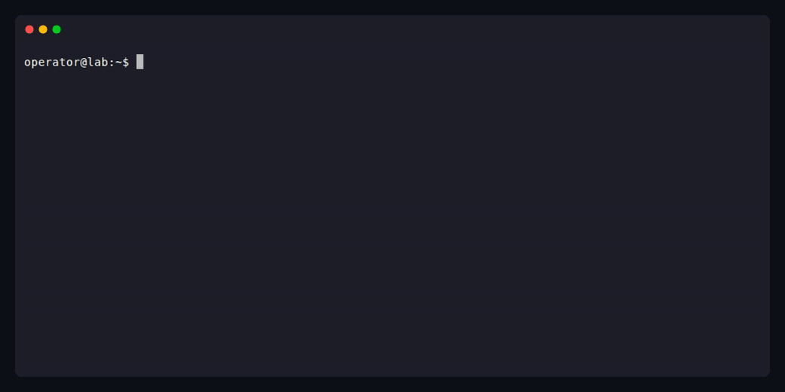

# laravel-file-manager 3.3.3 — insecure default configuration (CWE-434 / CWE-1188)

Security advisory, lab proof-of-concept and detection/remediation material for the
Composer package `alexusmai/laravel-file-manager` when it is deployed with the
configuration the package itself publishes.

> All work in this repository is **passive** (code analysis) or runs against an
> **isolated local Docker lab** (`127.0.0.1:18080`). No third-party system was
> contacted. This material is intended for defense, detection and responsible
> disclosure.

## Advisory summary

| Field | Value |
|---|---|
| Internal ID | LFM-2026-ADV-01 |
| Product | `alexusmai/laravel-file-manager` (Composer / Laravel package) |
| Affected version | 3.3.3 (latest published; the behavior has existed since 1.x) |
| Fixed version | None. Vendor treats deployment hardening as the integrator's responsibility (issues #185, #187). |
| Vulnerability class | Unrestricted file upload leading to remote code execution |
| CWE | CWE-434 (Unrestricted Upload of File with Dangerous Type), CWE-1188 (Insecure Default Initialization of Resource) |
| CVE | None assigned to this unauthenticated variant. Related: CVE-2025-56399 (authenticated upload/rename variant). |
| CVSS v3.1 | **9.8 Critical** — `AV:N/AC:L/PR:N/UI:N/S:U/C:H/I:H/A:H` (default deployment) |
| Attack vector | Network, unauthenticated |
| Status | Reproduced in an isolated local lab. No third-party system contacted. |
| Date | 2026-11-14 |

## Summary

The configuration published by the package leaves the file manager reachable
**without authentication** (`middleware => ['web']`), with **no extension
restriction** (`allowFileTypes => []`) and with **ACL disabled** (`acl => false`),
on the `public` disk. In a standard Laravel deployment where `php artisan
storage:link` has been run and the web server executes PHP under `/storage`, these
defaults chain into an arbitrary file upload that ends in command execution as the
web-server user.

Exploitability **depends on configuration, not only on the version**: adding `auth`
middleware, enabling ACL, restricting `allowFileTypes`, using a private disk, or
blocking PHP execution under the storage path each break the chain. Those controls
are the integrator's responsibility — but the values the package ships are insecure
by default.

## Why it is vulnerable (root cause)

The problem is not a single bug but the **combination of five shipped defaults**,
each individually defensible, that together form a complete upload-to-execution
chain. Code references are against the reviewed copy at commit `74bebe32`.

1. **Routes without authentication.**
   `config/file-manager.php:98` ships `'middleware' => ['web']`. Laravel's `web`
   group provides session state and CSRF protection, but **not** authentication.
   `src/routes.php` applies that group to `GET initialize`, `POST upload`,
   `POST rename` and the rest, so every file-manager route is reachable by an
   anonymous client.

2. **CSRF is not an obstacle.**
   Because the routes run in the `web` group, `GET /file-manager/initialize` issues
   a fresh `XSRF-TOKEN` cookie to the caller. An unauthenticated client simply reads
   that cookie and echoes it back in the `X-XSRF-TOKEN` header, so Laravel's CSRF
   check passes. CSRF protection only stops cross-origin forgery, not a direct
   client that holds its own token.

3. **No allow-list of extensions.**
   `config/file-manager.php:85` ships `'allowFileTypes' => []`, documented as "no
   restrictions". In `src/FileManager.php` the extension check is only applied when
   that list is non-empty, so with the default the upload accepts any extension,
   including `.php`/`.phtml`/`.phar`.

4. **The original client filename is preserved.**
   `src/FileManager.php:159-185` takes `getClientOriginalName()` and passes it to
   `putFileAs()`. The stored file keeps the attacker-chosen name and extension — no
   random name, no server-side normalization — so an uploaded `x.php` lands on disk
   as `x.php`.

5. **Public, web-executable storage.**
   The default disk is `public` (`storage/app/public`). Laravel's documented setup
   exposes it through `php artisan storage:link`, and a typical Apache/nginx host
   with the PHP handler enabled will **execute** `.php` files under that symlinked
   path. The written file therefore runs with the privileges of the web-server user.

A sixth default widens the surface: `src/FileManager.php:274-277` implements
`rename` **without re-validating the new extension**. Even if `allowFileTypes` were
set to image types only, an attacker could upload a valid image and rename it to
`.php`, because the rename path never re-checks the extension.

Put together: an anonymous request obtains a CSRF token from `initialize`, the
unrestricted upload stores an attacker-named PHP file on the public disk, and a
subsequent request to that file under `/storage/` is executed by the web server —
**unauthenticated remote code execution in the default deployment**.

### CVSS v3.1 breakdown

`CVSS:3.1/AV:N/AC:L/PR:N/UI:N/S:U/C:H/I:H/A:H` → **9.8 Critical**

| Metric | Value | Rationale |
|---|---|---|
| Attack Vector (AV) | Network | Reachable over HTTP. |
| Attack Complexity (AC) | Low | No race or special conditions; the token is served on request. |
| Privileges Required (PR) | None | No authentication in the default config. |
| User Interaction (UI) | None | Fully server-side. |
| Scope (S) | Unchanged | Impact stays within the web application's authority. |
| Confidentiality / Integrity / Availability | High | Command execution as the web user allows reading secrets, writing files and disrupting service. |

The 9.8 score assumes the published default deployment. With authentication or a
private disk the score drops (e.g. 8.8 with low privileges for the authenticated
CVE-2025-56399 variant).

## Exploitation requirements

The chain only completes when **all** of the following hold — it is a
configuration-dependent issue, not a blanket "any install is vulnerable":

- A reachable instance with the package installed and its routes registered.
- No `auth` (or other access control) added to the package middleware group, and no
  global authentication enforced by the application.
- `allowFileTypes` empty (default) or permitting an executable extension; or the
  `rename` route reachable.
- A URL-reachable disk (`storage:link`) on a server that executes PHP at that path.

## Impact

- Arbitrary command execution as the web-server user (`www-data` in the lab).
- Read/write of any file that user can reach, including `APP_KEY`, database
  credentials and other secrets.
- Web-shell persistence, scheduled tasks and lateral movement depending on the
  environment — potentially full host compromise.

## Demonstration (local lab)



Real recording of the PoC against the `lab/` environment on `127.0.0.1:18080`:
reconnaissance via `GET /file-manager/initialize` (`acl=false`, `public` disk),
the PoC run, and the output of `id; whoami; hostname` as `www-data`. The
reproducible script is in [`demo/lfm-rce-demo.tape`](demo/lfm-rce-demo.tape) and
requires [`vhs`](https://github.com/charmbracelet/vhs) with the lab running.

## Reproducing in the lab

```bash
# Isolated lab (loopback only)
cd lab && docker compose build && docker compose up -d && cd ..

# PoC against the local lab
python3 poc/lfm_upload_rce_poc.py --base-url http://127.0.0.1:18080 --cmd 'id; whoami; hostname'

# Stop and clean up
cd lab && docker compose down
```

The lab is published only on `127.0.0.1:18080`; it must not be exposed beyond
loopback nor used against third-party systems.

### Negative controls (verified)

| Change | Result |
|---|---|
| `'middleware' => ['web','auth']` | `initialize` no longer returns 200; the chain stops (login redirect in a real app). |
| `'allowFileTypes' => ['jpg','jpeg','png','gif']` | upload returns `{"status":"warning","message":"notAllUploaded"}`; the `.php` is not stored and the PoC ends without execution. |

## Detection

- `POST` to `*/file-manager/upload` without an authenticated session, especially
  with `files[]` and `.php` names.
- Appearance of `.php` files in `storage/app/public` or any web-served disk.
- `GET` requests to `/storage/*.php` with command-like parameters.
- `POST */file-manager/rename` followed by access to a `.php` file.
- `initialize` responses with `"acl":false` from non-administrative sources.

## Remediation

1. Add authentication/authorization to the package group:
   `'middleware' => ['web','auth','admin']` or equivalent; verify with
   `php artisan route:list -v`.
2. Restrict extensions (`allowFileTypes => ['jpg','jpeg','png','gif','pdf']`) and
   validate server-side with `mimes`/`extensions` rules.
3. Enable ACL (`acl => true`) with a whitelist strategy where applicable.
4. Move uploads to a private disk (`storage/app/private`) and serve them through an
   authorized controller.
5. Disable PHP execution under the storage path (Apache `php_admin_flag engine off`
   / nginx `location ~ \.php$ { return 403; }`).
6. Hunt for and remove unexpected `.php` files under the public disk; rotate
   `APP_KEY` and credentials if compromise is suspected.

## Repository contents

| Path | Description |
|---|---|
| `README.md` | This advisory (full technical write-up). |
| `advisory/LFM-2026-ADV-01-arbitrary-upload-rce.md` | Long-form advisory with code references, timeline and negative controls. |
| `poc/lfm_upload_rce_poc.py` | PoC in Python stdlib. Default target `127.0.0.1:18080`; lab-only. |
| `lab/` | Reproducible Docker lab (Laravel 12 + PHP 8.3 + Apache + package 3.3.3, published config unchanged). |
| `demo/` | Demonstration GIF and its VHS script. |

## Timeline

- 2020-07-11/19 — Public issues #185 and #187 document the extension-change and the
  `web`-middleware risk.
- 2025-10-28 — CVE-2025-56399 (authenticated upload/rename variant).
- 2026-05-12 — Release 3.3.3 ships the same insecure defaults.
- 2026-11-14 — Local unauthenticated reproduction, PoC and this advisory.

## References

- https://github.com/alexusmai/laravel-file-manager/blob/3.3.3/config/file-manager.php
- https://github.com/alexusmai/laravel-file-manager/blob/3.3.3/src/routes.php
- https://github.com/alexusmai/laravel-file-manager/blob/3.3.3/src/FileManager.php
- https://github.com/alexusmai/laravel-file-manager/issues/185
- https://github.com/alexusmai/laravel-file-manager/issues/187
- https://nvd.nist.gov/vuln/detail/CVE-2025-56399
- https://laravel.com/docs/12.x/filesystem#the-public-disk
- https://laravel.com/docs/12.x/middleware#laravels-default-middleware-groups

## Disclosure and scope

The vendor considers deployment security the integrator's responsibility (public
issues #185 and #187). This material does not dispute that position: it documents
that the **published** values lead to an insecure deployment unless they are
changed, and it provides detection and remediation. Reproduction was performed in a
local, isolated lab with no interaction with third-party systems.

## License / use

Security research material. For use only on systems you own or are explicitly
authorized in writing to test.
